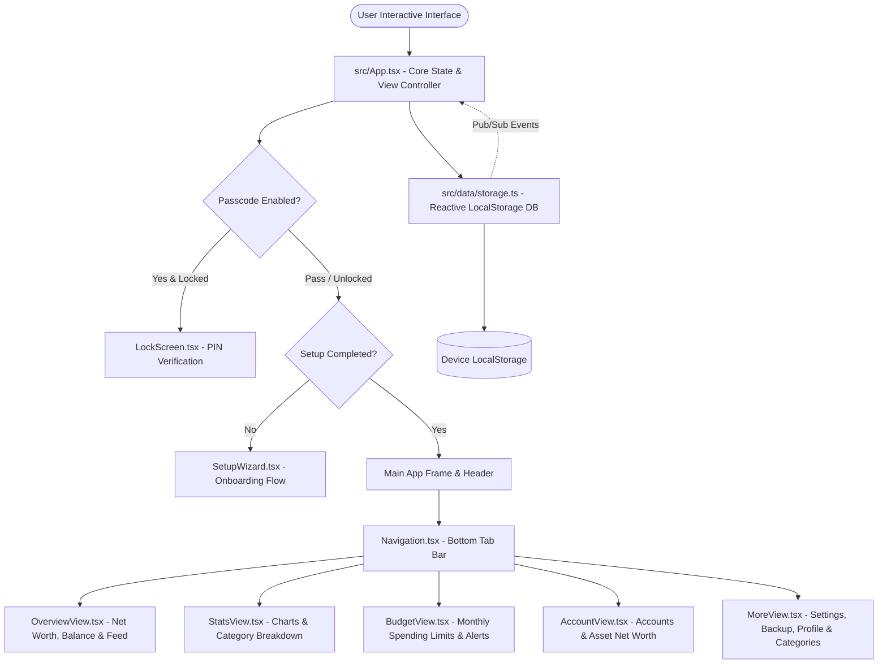

# 📱 In & Out - Money Manager & Financial Tracker (Full A to Z Documentation)

> **App Version**: `v1.1.0`  
> **Brand / Developer**: `niceTRY`  
> **Application ID**: `com.inandout.app`  
> **Target Platforms**: Web (PWA), Mobile Responsive Web, Native Android (`.apk`)

---

## 📋 Table of Contents
1. [App Overview & Identity](#-app-overview--identity)
2. [Tech Stack & Dependencies (A-Z)](#-tech-stack--dependencies-a-z)
3. [Architecture & System Flow](#-architecture--system-flow)
4. [Complete Feature Matrix (A to Z)](#-complete-feature-matrix-a-to-z)
5. [Complete File Directory & Source Code Map](#-complete-file-directory--source-code-map)
6. [Data Models & TypeScript Interfaces](#-data-models--typescript-interfaces)
7. [Storage, Backup & CSV Engine](#-storage-backup--csv-engine)
8. [Security & Passcode System](#-security--passcode-system)
9. [Developer Guide & CLI Commands](#-developer-guide--cli-commands)

---

## 🌟 App Overview & Identity

**In & Out** is a modern, lightweight, privacy-focused personal finance and money management application. Designed with a warm minimalist **Bento Grid** aesthetic (`#F9F7F2` canvas background, `#5A5A40` warm olive primary accents, and `#2D2926` high-contrast typography), the app offers an intuitive experience for tracking income, expenses, account transfers, budgeting, and net worth analysis.

### Core Philosophy:
- **Privacy First**: All data is stored 100% locally on the user's device via `localStorage`. No mandatory sign-up or remote tracking.
- **Fast & Responsive**: Built with React 19 and Vite for instant load times and zero interface lag.
- **Cross-Platform Native Support**: Mobile-first design wrapped in **Capacitor 8.5** to run as a native Android app (`.apk`) or a Progressive Web App (PWA).

---

## 🛠 Tech Stack & Dependencies (A-Z)

| Library / Tool | Version | Role / Purpose |
| :--- | :--- | :--- |
| **@capacitor/android** | `^8.5.2` | Native Android platform wrapper for Capacitor. |
| **@capacitor/core** | `^8.5.2` | Bridge between web view JS and native mobile device features. |
| **@google/genai** | `^2.4.0` | Official Google Gemini AI SDK for financial intelligence and automated insights. |
| **@tailwindcss/vite** | `^4.1.14` | High-performance CSS utility framework integration for Vite. |
| **@vitejs/plugin-react** | `^5.0.4` | React fast-refresh plugin for Vite. |
| **Autoprefixer** | `^10.4.21` | PostCSS vendor prefixing tool for cross-browser CSS support. |
| **Dotenv** | `^17.2.3` | Environment variable management. |
| **Express** | `^4.21.2` | Lightweight server module for previewing/hosting builds. |
| **Lucide React** | `^0.546.0` | Modern, clean vector icon suite used throughout all components. |
| **Motion** (Framer) | `^12.23.24` | Production-grade fluid animations, modal transitions, and micro-interactions. |
| **React** | `^19.0.1` | UI component framework with modern hooks and fast reconciliation. |
| **React DOM** | `^19.0.1` | DOM renderer for React web application. |
| **Recharts** | `^3.10.1` | Interactive data charts (Pie charts, Bar charts, Area charts) for analytics. |
| **Tailwind CSS** | `^4.1.14` | Modern CSS styling system with custom color tokens. |
| **TypeScript** | `~5.8.2` | Type-safe JavaScript application code. |
| **Vite** | `^6.2.3` | Next-generation frontend build tool and dev server. |

---

## 🏗 Architecture & System Flow



---

## ⚡ Complete Feature Matrix (A to Z)

### A. Account Management & Asset Tracking
- **Multi-Account Support**: Bank Accounts, Cash Wallets, Credit Cards, Savings, Investments, and custom wallets.
- **Net Worth Calculation**: Real-time aggregation of active account balances based on initial amounts + total income/expenses + transfers.
- **Account CRUD**: Create, edit initial balance/color/icon, and soft-archive accounts while retaining transaction history.

### B. Budgeting & Spending Alert Controls
- **Category-Specific Budgets**: Set spending limits for specific expense categories (e.g., Food, Entertainment).
- **Overall Monthly Budget**: Create an overarching monthly target budget.
- **Alert Engine**: Visual warning progress bars when spending hits designated threshold percentages (e.g. 80%).

### C. Category Customization Engine
- **Income & Expense Categories**: Pre-seeded default categories + ability to add custom user categories.
- **Vibrant Color Palettes**: Curated high-visibility color swatches + custom Hex color picker input (`#HEX`).
- **Dynamic Icon Picker**: Select from over 20+ Lucide icons for visual identity.

### D. Data Backup, Export & Portability
- **JSON Full Backup & Restore**: Export complete app state (Settings, Accounts, Categories, Transactions, Budgets, Notes) to JSON file; easily restore on any device.
- **CSV Transaction Export**: Export transaction log with dates, category names, account names, notes, and amounts formatted for Excel or Google Sheets.
- **Database Reset Modes**:
  - *Reset to Seed Data*: Restores default accounts and demo data.
  - *Reset to Clean Empty State*: Clears transactions and budgets while preserving base settings.

### E. Passcode Security & Privacy
- **Numeric PIN Passcode**: 4+ digit secure PIN lock system.
- **Auto-Lock Guard**: Automatically locks app upon launch when enabled.
- **Hide Balance Mode**: One-tap eye icon toggle (`Eye`/`EyeOff`) to mask net worth and balances (`₹ xxx`) on screen.
- **Biometrics Ready**: Toggle switch for biometric unlock preference.

### F. Search & Filter Engine
- **Full-text Keyword Search**: Search across notes and transaction descriptions.
- **Multi-Parameter Filtering**: Filter transactions by:
  - Date Range (Start Date / End Date)
  - Transaction Type (Income, Expense, Transfer)
  - Category & Account
  - Min / Max Amount limits

### G. Statistics & Interactive Analytics
- **Pie & Bar Charts**: Dynamic visual spending distribution powered by Recharts.
- **Period Switching**: View analytics per month or date window.
- **Percentage Breakdown**: Detailed percentage breakdown per category sorted by spending volume.

### H. Spending Trends & Visual Feed
- **Area & Line Trends Chart**: Smooth trend lines showing income vs expense trajectory over time.
- **Grouped Transaction Feed**: Transactions automatically ordered and grouped by date (Today, Yesterday, Specific Date).

### I. Onboarding Setup Wizard
- **First-Run Onboarding**: Welcomes new users, allows currency selection, configures initial cash balance, and sets up optional PIN security.

### J. User Feedback & Support System
- **In-App Feedback Form**: Allows users to rate the app (1-5 stars), select feedback category (Bug, Feature Request, Other), attach files, and send notes.
- **Help & FAQ Modal**: Quick access to usage tips and troubleshooting.

### K. Pro / Premium Upgrade Teaser
- **Pro Features Modal**: Sleek UI presenting upcoming Pro features (Unlimited Cloud Sync, Multi-Currency Auto-conversion, Receipt Scanning) with plan selectors (Monthly, Yearly, Lifetime).

---

## 📁 Complete File Directory & Source Code Map

```
d:\DOCUMENT\in&out\money-maganer-In-Out
├── APP.MD                          # Full A to Z documentation file
├── In&Out.apk                      # Compiled Android Native APK binary
├── In_And_Out.apk                  # Compiled Android Native APK binary
├── capacitor.config.ts             # Capacitor Native platform configuration
├── index.html                      # HTML entrypoint with metadata and PWA links
├── metadata.json                   # Project metadata
├── package.json                    # Dependencies, scripts, and build metadata
├── tsconfig.json                   # TypeScript compiler configuration
├── vite.config.ts                  # Vite bundler configuration & Tailwind setup
├── public/
│   ├── logo.png                    # App icon asset
│   └── manifest.json               # Web App Manifest for PWA installation
├── src/
│   ├── App.tsx                     # Primary React Application Root & Navigation Guard
│   ├── main.tsx                    # React DOM entrypoint mounting App
│   ├── index.css                   # Global CSS, theme variables, and Tailwind directives
│   ├── types.ts                    # Universal TypeScript data interfaces & types
│   ├── components/
│   │   ├── AccountView.tsx         # Account list, net worth card, and account manager
│   │   ├── AddTransactionModal.tsx # Income, Expense, Transfer entry modal
│   │   ├── BudgetView.tsx          # Monthly budget limits, progress, and alerts
│   │   ├── CategoryIcon.tsx        # Dynamic Lucide icon mapper component
│   │   ├── Header.tsx              # Top sticky header with app title, quick actions & lock
│   │   ├── LockScreen.tsx          # Passcode lock keypad screen
│   │   ├── Logo.tsx                # Custom SVG brand logo component
│   │   ├── MoreView.tsx            # Comprehensive Settings, Category editor, Backup, Profile
│   │   ├── Navigation.tsx          # Bottom floating navigation bar (5 main tabs)
│   │   ├── OverviewView.tsx        # Main dashboard, summary cards, and transaction list
│   │   ├── ProComingSoonModal.tsx  # Premium subscription modal & feature teaser
│   │   ├── SearchModal.tsx         # Search & filter modal dialog
│   │   ├── SetupWizard.tsx         # First-time user onboarding setup wizard
│   │   ├── SpendingTrendsChart.tsx # Recharts interactive trends component
│   │   ├── StatsView.tsx           # Category analytics and Pie/Bar chart breakdown
│   │   └── TransactionDetailModal.tsx # Detail view for inspecting/deleting transactions
│   ├── data/
│   │   ├── defaultData.ts          # Initial seed categories, default accounts, and settings
│   │   └── storage.ts              # LocalStorage CRUD database engine & event pub/sub
│   └── utils/
│       ├── formatters.ts           # Currency, date, and mathematical calculation helpers
│       └── haptics.ts              # Tactile haptic feedback engine for touch interactions
```

---

## 📐 Data Models & TypeScript Interfaces (`src/types.ts`)

### 1. `Account`
```typescript
export type AccountType = 'bank' | 'cash' | 'wallet' | 'credit_card' | 'savings' | 'investment' | 'other';

export interface Account {
  id: string;
  name: string;
  type: AccountType;
  initial_balance: number;
  currency: string;
  icon: string;
  color: string;
  is_active: boolean;
  created_at: string;
  updated_at: string;
}
```

### 2. `Category`
```typescript
export type CategoryType = 'income' | 'expense';

export interface Category {
  id: string;
  name: string;
  type: CategoryType;
  icon: string;
  color: string;
  is_default: boolean;
  is_active: boolean;
  created_at: string;
  updated_at: string;
}
```

### 3. `Transaction`
```typescript
export type TransactionType = 'income' | 'expense' | 'transfer';

export interface Transaction {
  id: string;
  type: TransactionType;
  amount: number;
  date: string; // YYYY-MM-DD
  category_id?: string | null;
  account_id?: string | null;
  from_account_id?: string | null;
  to_account_id?: string | null;
  note?: string;
  description?: string;
  created_at: string;
  updated_at: string;
}
```

### 4. `Budget`
```typescript
export interface Budget {
  id: string;
  name: string;
  category_id?: string | null; // null for overall budget
  amount: number;
  period: 'monthly' | 'weekly' | 'yearly';
  start_date: string;
  end_date: string;
  alert_percentage: number;
  created_at: string;
  updated_at: string;
}
```

### 5. `UserSettings`
```typescript
export interface UserSettings {
  currency: string;
  currency_symbol: string;
  language: string;
  theme: 'light' | 'dark' | 'midnight' | 'forest' | 'clay' | 'system';
  passcode_enabled: boolean;
  passcode_pin?: string;
  biometric_enabled: boolean;
  auto_lock_minutes: number;
  start_screen: 'daily' | 'calendar' | 'monthly' | 'total';
  date_format: string;
  notifications_enabled: boolean;
  show_totals?: boolean;
  hide_balance?: boolean;
  is_setup_completed: boolean;
  is_pro_user?: boolean;
  pro_plan?: 'monthly' | 'yearly' | 'lifetime';
  pro_unlocked_at?: string;
}
```

---

## 💾 Storage, Backup & CSV Engine (`src/data/storage.ts`)

The application uses an in-memory Pub/Sub event system attached to `localStorage`:

- **`subscribeStorage(listener)`**: Components register state sync callbacks when storage changes.
- **`exportBackupJSON()`**: Serializes the full database object into a structured JSON string.
- **`importBackupJSON(jsonString)`**: Validates and writes external backup JSON directly to storage keys.
- **`exportTransactionsCSV()`**: Converts all transactions into a comma-separated format matching standard spreadsheet requirements.

---

## 🔒 Security & Passcode System (`src/components/LockScreen.tsx`)

- **PIN Verification**: Compare input PIN against `settings.passcode_pin`.
- **Haptic Keypad**: Gives tactile vibration response on button touch.
- **Auto-Guard**: App checks `passcode_enabled` on load and forces the LockScreen before rendering main content.

---

## 🚀 Developer Guide & CLI Commands

### 1. Installation & Environment Setup
```bash
# Install dependencies
npm install
# or
bun install
```

### 2. Development Server
```bash
npm run dev
# Starts Vite dev server on http://localhost:3000
```

### 3. Production Build & Linting
```bash
# Type check without emitting files
npm run lint

# Build production bundle to /dist
npm run build
```

### 4. Capacitor Android Sync & Build
```bash
# Sync web build to native Android project
npx cap sync android

# Open Android Studio to build APK
npx cap open android
```

---
*Document generated for **In & Out - Money Manager** (`v1.1.0`)*
